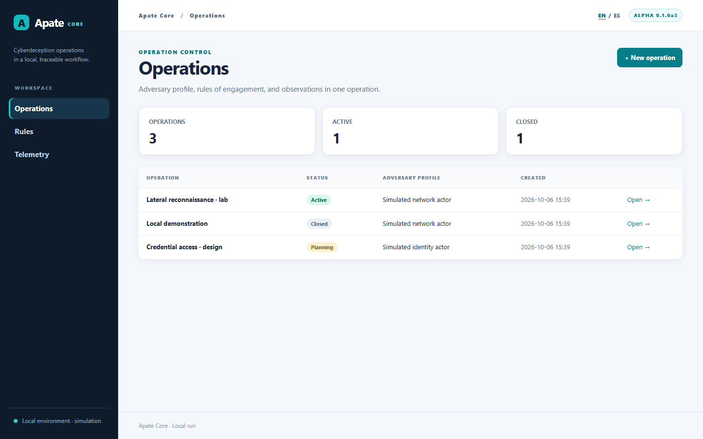
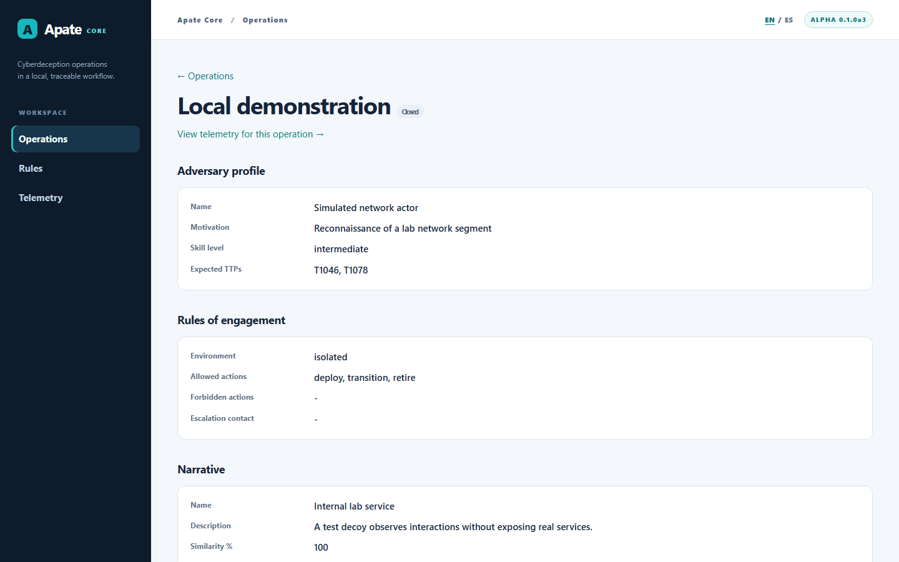
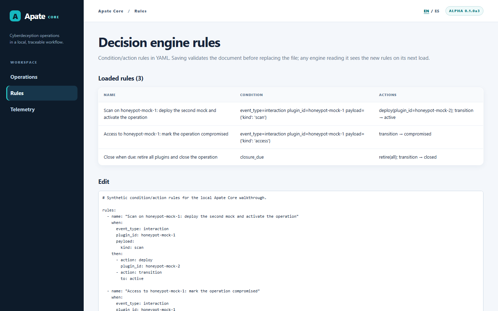
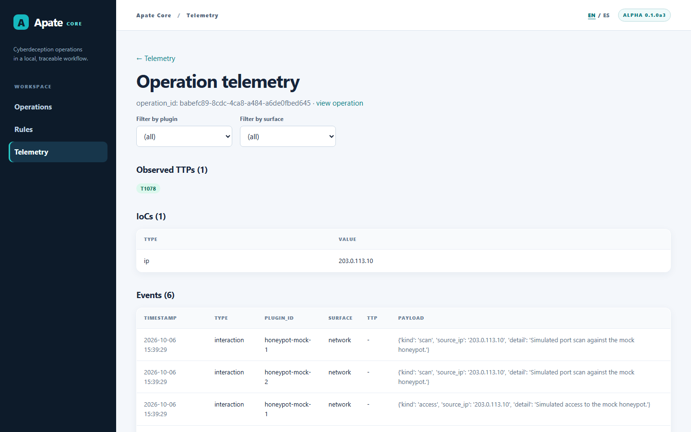

# Apate Core

[English](README.md) · Español

**Una herramienta abierta de ciberengaño centrada en la operación, con interfaz gráfica local.**

Apate Core reúne el modelo de operación, reglas deterministas, eventos de plugins y telemetría básica. Su interfaz permite crear y revisar operaciones, editar reglas YAML y explorar eventos observados. El honeypot incluido es **simulado**: el recorrido funciona sin desplegar señuelos reales ni conectarse a infraestructura corporativa.

> **Las capturas son de la GUI real de Apate Core en inglés**, ejecutada localmente con datos sintéticos en inglés de [`examples/seed_gui.py`](examples/seed_gui.py). No son maquetas ni imágenes de Parallax. El selector **EN / ES** permite volver al español.

## La herramienta

### Operaciones

Vista de planificación, estado y perfil de adversario. Las tres operaciones de la imagen fueron generadas por el script de demostración.



### Detalle de una operación

El perfil de adversario, las reglas de interacción (RoE), la narrativa, los escenarios, los plugins vinculados y el estado quedan asociados a una misma operación. La interfaz permite crear operaciones y aplicar transiciones manuales válidas.



### Reglas y telemetría

La vista de reglas muestra las condiciones y acciones cargadas y valida el YAML antes de guardarlo. La telemetría permite filtrar eventos por plugin y superficie y consultar TTP e indicadores observados. Todo lo que aparece en estas capturas es sintético.





## Reproducir las capturas

Necesitás Git y Python 3.10 o superior. La instalación descarga dependencias de Python; el ejemplo y la aplicación local no requieren servicios externos. El servidor escucha en `127.0.0.1` y no tiene autenticación de usuarios: usalo sólo en tu equipo.

**macOS / Linux**

```bash
git clone https://github.com/fedequark/Apate-Cyberdeception.git
cd Apate-Cyberdeception
python3 -m venv .venv
source .venv/bin/activate
python -m pip install -e ".[dev]"
python examples/seed_gui.py --lang en
python -m apate.web
```

**Windows PowerShell**

```powershell
git clone https://github.com/fedequark/Apate-Cyberdeception.git
Set-Location Apate-Cyberdeception
py -3 -m venv .venv
.\.venv\Scripts\python.exe -m pip install -e ".[dev]"
.\.venv\Scripts\python.exe examples/seed_gui.py --lang en
.\.venv\Scripts\python.exe -m apate.web
```

Abrí **[http://127.0.0.1:5000/operations/?lang=en](http://127.0.0.1:5000/operations/?lang=en)**. Desde el menú lateral podés entrar a **Rules** y **Telemetry**; el selector **EN / ES** cambia el idioma de la interfaz. Detené el servidor con `Ctrl+C`. Para ejecutar las pruebas, usá `python -m pytest -q` en el entorno virtual.

Con `--lang en`, el script crea tres operaciones ficticias en inglés: una en planificación, otra activa y una cerrada con eventos; también prepara reglas y descripciones de eventos en inglés. Guarda los datos en `.apate_data/`, excluido de Git. Para reproducir las capturas, ejecutalo en un directorio limpio: una nueva ejecución conserva el archivo de reglas anterior y agrega otras operaciones. `--lang es` genera datos de demostración en español. Si querés una interfaz vacía, iniciá `python -m apate.web` sin ejecutar el script.

La suite local pasa **117 pruebas**. La [CI](https://github.com/fedequark/Apate-Cyberdeception/actions/workflows/tests.yml) ejecuta las pruebas y ambos ejemplos en Windows y Ubuntu con Python 3.10 y 3.12; allí se ve el resultado del commit más reciente.

## Qué demuestra el ejemplo

[`examples/quickstart.py`](examples/quickstart.py), invocado por el script de la GUI, crea una operación y vincula dos plugins simulados. Un escaneo sintético activa una regla que despliega el segundo mock y cambia el estado a activo. Un acceso simulado la marca comprometida y registra una observación `T1078`. Finalmente, `check_closure()` evalúa una fecha vencida, retira ambos mocks y cierra la operación. Las [reglas de ejemplo](examples/rules_example.yaml) se pueden consultar y modificar.

El ejemplo persiste `.apate_data/operations/<operation-id>.json` y `.apate_data/telemetry/<operation-id>.json`; la GUI lee esos archivos. **La GUI edita reglas, pero no ejecuta un motor de reglas ni un planificador en segundo plano.** Un proceso que instancie `RuleEngine` carga las reglas editadas en su próxima lectura. Las transiciones manuales de la interfaz son independientes de las acciones del motor.

## Arquitectura y alcance

| Componente | Incluido en Apate Core |
| --- | --- |
| GUI local | Crear, listar y consultar operaciones; transiciones válidas; revisión y edición de YAML; lectura de telemetría. |
| Operación | Perfil de adversario, RoE, narrativa, escenarios, plugins vinculados, criterios de cierre y persistencia JSON. |
| Reglas | Condiciones y acciones declarativas, aplicación de RoE, alcance por operación/plugin y límite a cascadas recursivas. |
| Plugins | Contrato `deploy()`/`rotate()`/`retire()`, bus síncrono y un `MockHoneypotPlugin` sintético. |
| Telemetría | Registro normalizado por evento, payload original, TTP e indicadores conocidos. |

Las reglas se parsean con `yaml.safe_load`; un YAML inválido no reemplaza el archivo guardado. `allowed_actions` y `forbidden_actions` limitan las acciones **del motor** mediante firmas como `deploy` o `transition:closed`; una prohibición prevalece. El motor ignora eventos de otras operaciones o plugins no vinculados y limita las cadenas recursivas. Estas guardas no autentican operadores ni protegen llamadas manuales a plugins.

El diseño centrado en la operación se apoya en la investigación de Federico Pacheco y Diego Staino sobre CTI y ciberengaño. Esta edición ofrece una base ejecutable; no implementa la metodología completa de siete pasos ni incluye un catálogo MITRE Engage. Los eventos de la demo no demuestran efectividad defensiva en campo.

## Apate Core y Parallax

**Apate Core** es la herramienta pública y de código abierto. **Parallax** es un producto comercial separado, desarrollado en un repositorio privado. Esta edición no incluye sus capacidades empresariales, integraciones de identidad, ledger gobernado, conectores corporativos ni stacks de terceros. La GUI local no tiene login. La persistencia JSON carece de control de concurrencia, cifrado y auditoría resistente a alteraciones.

## Licencia y colaboración

Apate Core se distribuye bajo [AGPL-3.0-or-later](LICENSE). Copyright © 2025 BASE4 Security. Autor del software: Federico Pacheco. Este repositorio no incluye código vendorizado de terceros. Para reportar un problema o proponer una mejora acotada, abrí un [issue](https://github.com/fedequark/Apate-Cyberdeception/issues) con versión de Python, pasos de reproducción y resultado esperado, sin credenciales reales ni telemetría sensible.
