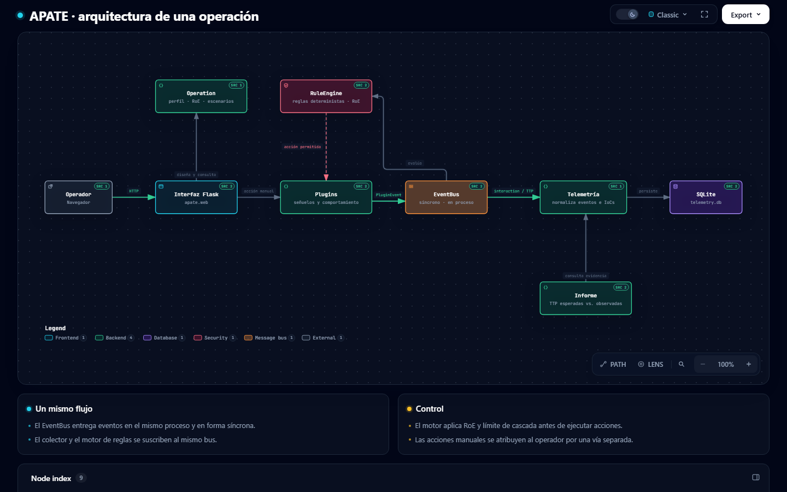
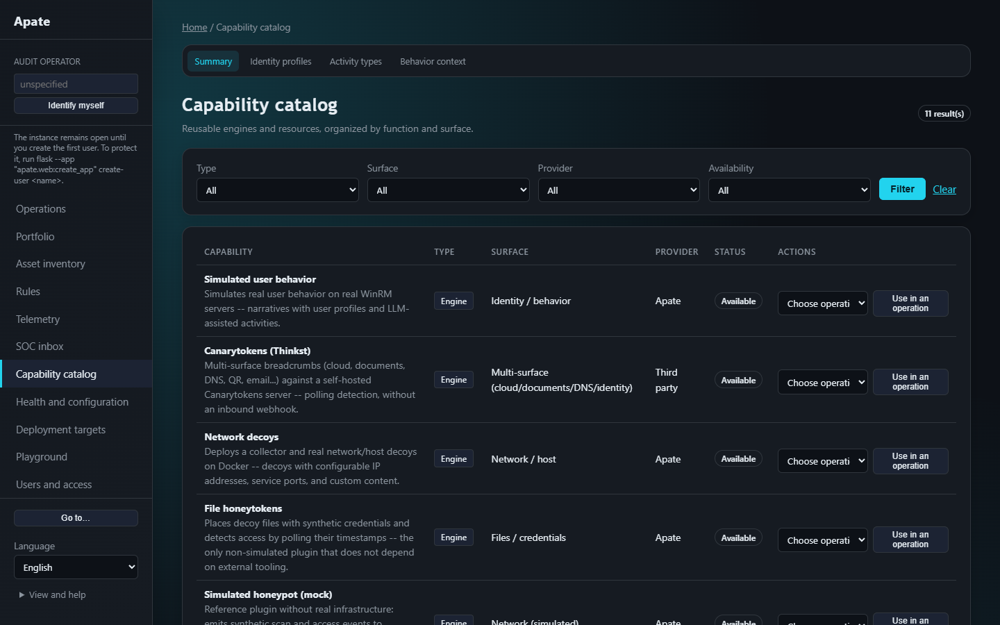

# Apate

[Español](README.es.md) · [Project showcase](https://fedequark.github.io/apate-showcase/)

**Open-source cyberdeception orchestration, centered on the operation.**

Apate helps an operator design a deception operation, bind decoys and simulated identity behavior, observe interactions, apply deterministic rules within rules of engagement, and review the evidence. Its web console supports Spanish and English. The decision engine does not use an LLM to authorize or deploy a capability.

This repository contains the **complete community edition**, including its web console, integrations, telemetry, reporting, and governance features. It has no license gate or artificial usage limit.

## What is included

| Area | Community capability |
| --- | --- |
| Operations | Adversary profile, scenarios, narrative, rules of engagement, lifecycle, templates, portfolio, and operation history. |
| Deception | Mock and honeytoken capabilities, integrations for DOLOS-T, BUDA, Canarytokens, OpenCanary, and Cyber Deception Playground; third-party plugin discovery. External systems need their own prerequisites. |
| Decisions | YAML condition/action rules, deterministic evaluation, operation and capability scope, rules-of-engagement checks, and rejection records. |
| Observation | Normalized telemetry, TTPs and indicators, incidents, TLP classification, case inbox, and an external telemetry bridge. |
| Governance | Local identities, fixed roles, team isolation, optional OIDC, operator audit, approved plans, execution limits, and local secret encryption. |
| Analysis and output | ATT&CK and Engage catalogs, CTI extraction, asset coverage, dry runs, reports, PDF, STIX 2.1, GraphML, and generic SIEM/SOAR export. |

## Architecture at a glance



This diagram was generated with [Archify](https://github.com/tt-a1i/archify) from the APATE operation flow. The [architecture guide](docs/architecture.md) covers the module relationships in more detail.

The [user guide](docs/guia-de-uso.md) walks through the actual console. The [architecture](docs/architecture.md), [plugin and event contract](docs/plugin-event-contract.md), and [production installation guide](docs/instalacion-produccion.md) provide more detail. These guides are currently written in Spanish.

## The console

These are screenshots of the **running Apate GUI in English**, captured locally from the included synthetic example operations. The telemetry counts come from generated test data, not a field deployment.

**Operations and current status**


**One operation's status, evidence and next action**


**Available deception capabilities**



**Telemetry and evidence**


## Run locally

Python 3.10 or newer is required. A local first run does not require an AD domain, SIEM, IdP, or Docker. Those systems are needed only for the integrations that use them.

```bash
git clone https://github.com/Base4Security/Apate-Cyberdeception.git
cd Apate-Cyberdeception
python -m venv .venv
# macOS/Linux: source .venv/bin/activate
# Windows PowerShell: .\.venv\Scripts\Activate.ps1
python -m pip install -e ".[dev]"
python -m apate.web
```

Open [http://127.0.0.1:5000](http://127.0.0.1:5000). The development server binds to loopback by default. With no local users, the first run is open for setup and demos; create a local administrator before exposing the application to other users. Operational data is stored under `.apate_data/` by default and is ignored by Git.

To load **synthetic example operations** into a disposable local data directory, stop the server and run `python examples/seed_demo.py` before starting it again. Set `APATE_LOCALE=en` first to seed English example content. The language selector changes the interface, but does not translate previously saved operation names or events.

To run it as a container instead:

```bash
docker build -t apate .
docker run -p 127.0.0.1:8080:8080 -e APATE_SECRET_KEY=<long-random-value> -v apate-data:/data apate
```

The container runs as an unprivileged user and stores its data in `/data`. Add `-e APATE_SEED_DEMO=1` to load the synthetic example operations on start.

Run the test suite with `python -m pytest`. Local tests cover contracts and synthetic workflows; the real AD/SMB, Vault, IdP, SIEM, Docker, and operator-evaluation gates require external infrastructure and are not claimed as complete here.

## License and attribution

Apate is licensed under **AGPL-3.0-or-later**; see [LICENSE](LICENSE), [NOTICE](NOTICE), and [CONTRIBUTING.md](CONTRIBUTING.md).

The bundled DOLOS-T and BUDA sources retain their attribution and licenses under `src/DOLOST/` and `src/BUDA/`; they are modified copies of the upstream projects (see [NOTICE](NOTICE)). The bundled Cyber Deception Playground stack retains its own license under `playground-stack/`. Curated subsets of MITRE ATT&CK® and MITRE Engage™ data are included under `src/apate/data/`; © The MITRE Corporation, see [NOTICE](NOTICE). Review those notices before redistributing a modified build.

## Status

This is a release candidate under local verification. The repository does not claim field effectiveness, production high availability, or completed integration tests against external infrastructure. See [release gates](docs/release-gates.md) and [SECURITY.md](SECURITY.md) before deployment.
