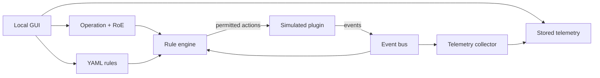

# Apate Core

English · [Español](README.es.md)

**An open-source, operation-centered cyberdeception tool with a local GUI.**

[](https://github.com/fedequark/Apate-Cyberdeception/actions/workflows/tests.yml)


Apate Core brings an operation model, deterministic rules, plugin events, and basic telemetry into one workflow. Its local web interface lets you create and inspect operations, edit YAML rules, and explore observed events. The included honeypot is **simulated**: you can run the full example without deploying a decoy, opening a network listener, or connecting to enterprise infrastructure.

> **What the screenshots show:** the actual Apate Core GUI running locally with synthetic data from [`examples/seed_gui.py`](examples/seed_gui.py). They are not mockups or screenshots of Parallax. The current GUI labels are in Spanish; the captions below explain each view in English.

## The tool

### Operations

One place to see operation state, adversary context, and the path to each operation's details. The three rows below are a synthetic planning, active, and closed operation created by the included seed script.


### Operation detail

An operation keeps its adversary profile, rules of engagement (RoE), narrative, scenarios, plugin bindings, and lifecycle together. The GUI can create an operation and apply a valid manual state transition.


### Rules and telemetry

The Rules view lists the loaded condition/action rules and validates YAML before saving it. The Telemetry view filters normalized events by plugin and surface, and shows observed TTPs and indicators. All data pictured here is synthetic.


## Run the same GUI locally

**Requirements:** Git and Python 3.10 or newer. Installation downloads Python dependencies; the example and web interface do not need external services. The server binds to `127.0.0.1` and has no user authentication, so keep it on your own machine.

<details open>
<summary><strong>macOS / Linux</strong></summary>

```bash
git clone https://github.com/fedequark/Apate-Cyberdeception.git
cd Apate-Cyberdeception
python3 -m venv .venv
source .venv/bin/activate
python -m pip install -e ".[dev]"
python examples/seed_gui.py
python -m apate.web
```

</details>

<details>
<summary><strong>Windows PowerShell</strong></summary>

```powershell
git clone https://github.com/fedequark/Apate-Cyberdeception.git
Set-Location Apate-Cyberdeception
py -3 -m venv .venv
.\.venv\Scripts\python.exe -m pip install -e ".[dev]"
.\.venv\Scripts\python.exe examples/seed_gui.py
.\.venv\Scripts\python.exe -m apate.web
```

</details>

Open **[http://127.0.0.1:5000/operations/](http://127.0.0.1:5000/operations/)** in your browser. Use the sidebar to navigate to **Reglas** (Rules) and **Telemetría** (Telemetry). Stop the local server with `Ctrl+C`. To run the tests, use `python -m pytest -q` in the same virtual environment.

`seed_gui.py` runs the complete mock workflow once and adds two more synthetic operations so the GUI opens with meaningful data. It writes under `.apate_data/`, which Git ignores. Running it again adds another set of operations. To try an empty workspace, skip the seed step and start `python -m apate.web` directly.

The current local suite passes **115 tests**. [GitHub Actions](https://github.com/fedequark/Apate-Cyberdeception/actions/workflows/tests.yml) runs the suite and both examples on Windows and Ubuntu with Python 3.10 and 3.12; check that page for the latest commit's result.

## What happens in the example

[`examples/quickstart.py`](examples/quickstart.py), which the GUI seed invokes, demonstrates the rule engine separately from the browser:

1. It creates an `Operation` with an adversary profile, narrative, RoE, and two bound mock plugins.
2. It attaches a `RuleEngine` and `TelemetryCollector` to one synchronous `EventBus`, loading [`examples/rules_example.yaml`](examples/rules_example.yaml).
3. Deploying the first mock emits a synthetic scan; a rule deploys the second and marks the operation active.
4. A simulated access marks the operation compromised and records a synthetic `T1078` observation.
5. An explicit `check_closure()` call evaluates a past due date, retires the mocks, and closes the operation.

The example saves `.apate_data/operations/<operation-id>.json` and `.apate_data/telemetry/<operation-id>.json`. The GUI reads those files. **The GUI edits the rules file but does not run a background rule engine or scheduler**; a process that instantiates `RuleEngine` loads the edited rules on its next read. The GUI's manual transitions are separate from rule-engine actions.

## Architecture and scope

| Component | Included in Apate Core |
| --- | --- |
| Local GUI | Create/list/detail operations, apply valid state transitions, view/edit YAML rules, and inspect telemetry. |
| Operation model | Adversary profile, RoE, narrative, scenarios, plugin bindings, closure criteria, lifecycle, and local JSON persistence. |
| Deterministic rules | Declarative conditions and actions; RoE checks, operation/plugin scope checks, and a recursive-chain limit. |
| Plugin contract | `deploy()` / `rotate()` / `retire()`, synchronous in-process event bus, and one synthetic `MockHoneypotPlugin`. |
| Basic telemetry | One normalized record per event, original payload, observed TTPs and known indicator fields. |



The operation-centered design is informed by Federico Pacheco and Diego Staino's CTI-to-cyberdeception research. This is an executable foundation for that architecture, not an implementation of the entire seven-step methodology or a claim of field effectiveness. A MITRE Engage catalog is not packaged in this release.

### Rules and RoE

Rules are YAML, not executable Python. They can match `interaction` or `ttp_observed` events by plugin and payload, or `closure_due: true`; actions are `deploy`, `rotate`, `retire`, and `transition`. The [example rules file](examples/rules_example.yaml) covers scan, access, and closure. `yaml.safe_load` parses the document, and invalid YAML is rejected without replacing the saved file.

`RulesOfEngagement.allowed_actions` and `forbidden_actions` constrain **rule-engine actions** through signatures such as `deploy`, `deploy:honeypot-mock-2`, and `transition:closed`. A prohibition wins; an empty allowlist does not restrict actions. The engine ignores events from other operations or unbound plugins, bounds recursive event chains, and keeps RoE/cascade rejections in memory for that process. These guards do not authenticate human users or secure manual plugin calls.

### Extend with a plugin

Subclass [`DeceptionPlugin`](src/apate/plugins/base.py), implement lifecycle methods, validate state with `_require_state()`, and publish `PluginEvent` values with `_publish()`. Register the instance in `RuleEngine.plugins` and add a matching `PluginBinding` to its operation. [`MockHoneypotPlugin`](src/apate/plugins/mock.py) is the reference implementation. An external deployment plugin would need its own authorization, cleanup, network boundaries, error handling, and event normalization.

## Apate Core and Parallax

**Apate Core** is the public open-source tool. **Parallax** is a separate commercial product developed in a private repository. This Core release does not include Parallax's enterprise implementation, identity integrations, governed ledger, corporate deployment connectors, or third-party deception stacks. Its local GUI is for development and demonstration; it has no user login. Local JSON storage has no concurrency control, encryption, or tamper-resistant audit trail. Synthetic observations demonstrate software behavior, not a real intrusion.

## License and contribution

Apate Core is licensed under [AGPL-3.0-or-later](LICENSE). Copyright © 2025 BASE4 Security. Software author: Federico Pacheco. No third-party source code is vendored here. To report a bug or propose a focused improvement, open a [GitHub issue](https://github.com/fedequark/Apate-Cyberdeception/issues) with the Python version, reproduction steps, and expected behavior; never include real credentials or sensitive telemetry.
