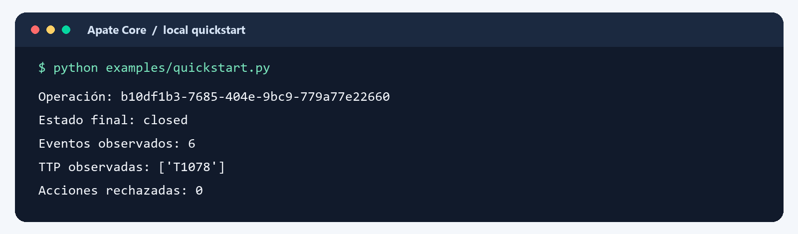
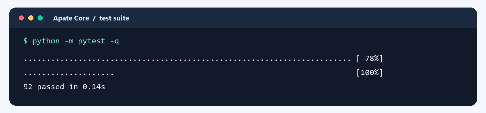
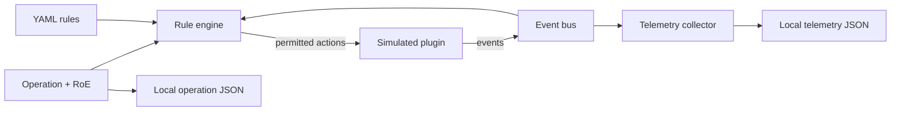

# Apate Core

English · [Español](README.es.md)

**An open, executable foundation for operation-centered cyberdeception.**

[](https://github.com/fedequark/Apate-Cyberdeception/actions/workflows/tests.yml)


Apate Core models a deception **operation** and connects its rules, plugin events, and observations in one local workflow. Its decisions are deterministic: a rule may call a plugin or transition an operation only within the configured rules of engagement (RoE). The included honeypot plugin is **simulated**. This release makes the architecture runnable and inspectable without deploying a decoy or connecting to an external system.

> **Start here:** clone the repository, run `examples/quickstart.py`, then inspect the generated operation and telemetry files. The complete walkthrough takes a few minutes and requires no accounts, credentials, containers, or lab infrastructure.

## See it run

This capture shows the **actual output** of `python examples/quickstart.py` on Apate Core `0.1.0a1`. The example simulates a scan and an access, applies three YAML rules, closes the operation, and writes local JSON records. The labels in the current example are Spanish: final state, observed events, observed TTPs, and rejected actions.



The operation ID changes on each run. `closed` is the final lifecycle state; `T1078` is a synthetic technique observation, **not evidence of a real attack**.

## Quick start

**Requirements:** Git and Python 3.10 or newer. Installation downloads the Python dependencies; running the example itself needs no network or external services.

<details open>
<summary><strong>macOS / Linux</strong></summary>

```bash
git clone https://github.com/fedequark/Apate-Cyberdeception.git
cd Apate-Cyberdeception
python3 -m venv .venv
source .venv/bin/activate
python -m pip install -e ".[dev]"
python examples/quickstart.py
python -m pytest -q
```

</details>

<details>
<summary><strong>Windows PowerShell</strong></summary>

```powershell
git clone https://github.com/fedequark/Apate-Cyberdeception.git
Set-Location Apate-Cyberdeception
py -3 -m venv .venv
.\.venv\Scripts\python.exe -m pip install -e ".[dev]"
.\.venv\Scripts\python.exe examples/quickstart.py
.\.venv\Scripts\python.exe -m pytest -q
```

</details>

The example writes `.apate_data/operations/<operation-id>.json` and `.apate_data/telemetry/<operation-id>.json`. That directory is ignored by Git. Re-running the example creates another operation rather than overwriting the previous one.



The captured local suite passed 92 tests. [GitHub Actions](https://github.com/fedequark/Apate-Cyberdeception/actions/workflows/tests.yml) also runs the suite and quickstart on Windows and Ubuntu with Python 3.10 and 3.12; use its current result for the latest commit.

## What is included

| Component | What you can do today |
| --- | --- |
| Operation model | Define an adversary profile, RoE, narrative, scenarios, plugin bindings, closure criteria, and lifecycle state. Save and load operations as local JSON. |
| Deterministic rules | Load condition/action rules from YAML; react to `interaction` and `ttp_observed` events or explicitly check whether closure is due. |
| Plugin contract | Implement `deploy()`, `rotate()`, and `retire()`; publish normalized events through a synchronous in-process bus. The shipped `MockHoneypotPlugin` produces synthetic events only. |
| Basic telemetry | Store one normalized record per event, retain its original payload, and query observed events, TTPs, and extracted indicators by operation. |



The bus runs synchronously in the same process. A plugin event can therefore trigger a rule and be recorded by telemetry during the same call. There is no background scheduler: the caller invokes `RuleEngine.check_closure()` to evaluate a due-date rule.

### Research context

The operation-centered design is informed by Federico Pacheco and Diego Staino's CTI-to-cyberdeception research. This repository exposes a small, executable foundation for that architecture; it does not implement the complete seven-step methodology or package a MITRE Engage catalog. The synthetic walkthrough demonstrates software behavior, not defensive effectiveness in the field.

## Follow the example

[`examples/quickstart.py`](examples/quickstart.py) is the shortest complete path through the project:

1. Create an `Operation` with an adversary profile, narrative, and RoE; bind two simulated plugins to it.
2. Attach a `TelemetryCollector` and a `RuleEngine` to the same `EventBus`; load [`examples/rules_example.yaml`](examples/rules_example.yaml).
3. Deploy the first mock plugin. Its synthetic scan event triggers a rule that deploys the second mock and marks the operation active.
4. Simulate an access. A second rule marks the operation compromised; telemetry records the synthetic interaction and `T1078` observation.
5. Set a past due date and call `check_closure()`. The closure rule retires the mocks and closes the operation.

You can inspect the files without using a database client. After running the example, this Python snippet reads one saved operation and its observations:

```python
from apate.core import JSONFileOperationRepository
from apate.telemetry import JSONFileTelemetryRepository, TelemetryCollector

operations = JSONFileOperationRepository(".apate_data/operations")
operation = next(operations.list())
collector = TelemetryCollector(
    repository=JSONFileTelemetryRepository(".apate_data/telemetry")
)

print(operation.name, operation.status.value)
print(collector.list_ttps(operation.id))
print([(ioc.type, ioc.value) for ioc in collector.list_iocs(operation.id)])
```

## Write a rule

Rules use a constrained, declarative YAML format. For example, this rule reacts only to a scan event from the named mock plugin:

```yaml
rules:
  - name: Deploy another simulated decoy after a scan
    when:
      event_type: interaction
      plugin_id: honeypot-mock-1
      payload:
        kind: scan
    then:
      - action: deploy
        plugin_id: honeypot-mock-2
      - action: transition
        to: active
```

Supported actions are `deploy`, `rotate`, `retire`, and `transition` (`active`, `compromised`, or `closed`). Conditions can match an event type, an optional plugin ID, and payload fields, or use `closure_due: true`. The parser uses `yaml.safe_load`; rules do not contain executable Python. See the [complete example](examples/rules_example.yaml) for the access and closure rules.

### Rules of engagement

`RulesOfEngagement.allowed_actions` and `forbidden_actions` constrain **rule-engine actions**. Signatures can be broad (`deploy`) or specific (`deploy:honeypot-mock-2`, `transition:closed`). A forbidden signature takes precedence. An empty allowlist means no allowlist restriction. The engine also ignores events from another operation or an unbound plugin, limits recursive event/action chains, and records RoE or cascade-limit rejections in `RuleEngine.rejected_actions` for that process.

These controls do **not** authorize a human operator, secure manual calls to plugins, or enforce network boundaries. Treat the `environment` and free-text legal fields as operation metadata; an external deployment integration must enforce its own infrastructure limits.

## Build a plugin

Subclass [`DeceptionPlugin`](src/apate/plugins/base.py), implement `deploy()`, `rotate()`, and `retire()`, validate lifecycle state with `_require_state()`, and publish `PluginEvent` values with `_publish()`. Register the plugin instance in `RuleEngine.plugins` **and** add a matching `PluginBinding` to the operation. The engine rejects a target that is not bound to that operation. [`MockHoneypotPlugin`](src/apate/plugins/mock.py) is the reference implementation.

The core does not ship integrations with external deception products. Adding one means implementing its deployment, cleanup, authorization, error handling, and event normalization separately; the abstract interface alone does not provide those guarantees.

## Scope, maturity, and Parallax

This is an **alpha library and local demonstration**, not a production control plane. It does not include a web console, accounts or OIDC, administrative API, durable governed ledger, enterprise approvals, external deployment connectors, or third-party deception stacks. Local JSON storage has no concurrency control, encryption, or tamper-resistant audit trail. The telemetry collector normalizes records and extracts known indicator fields; it does not establish attack causality or measure defensive effectiveness.

**Apate Core** is the public, open-source foundation. **Parallax** is a separate commercial product developed in a private repository. This repository contains no Parallax enterprise implementation. The separation lets the open core remain independently usable and auditable without implying that commercial capabilities are present here.

## License and authorship

Apate Core is licensed under [AGPL-3.0-or-later](LICENSE). Copyright © 2025 BASE4 Security. Software author: Federico Pacheco. No third-party source code is vendored in this repository. For bugs or focused improvements, open a [GitHub issue](https://github.com/fedequark/Apate-Cyberdeception/issues) with the Python version, reproduction steps, and expected behavior; avoid including real credentials or sensitive telemetry.
