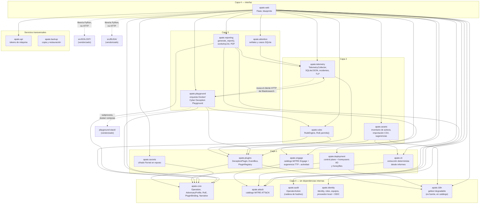
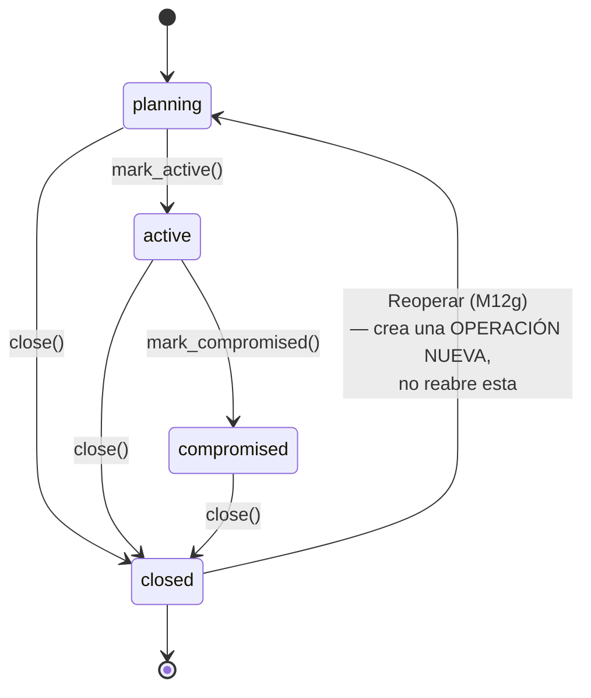
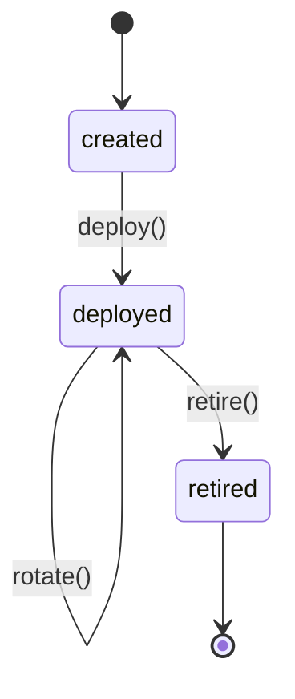
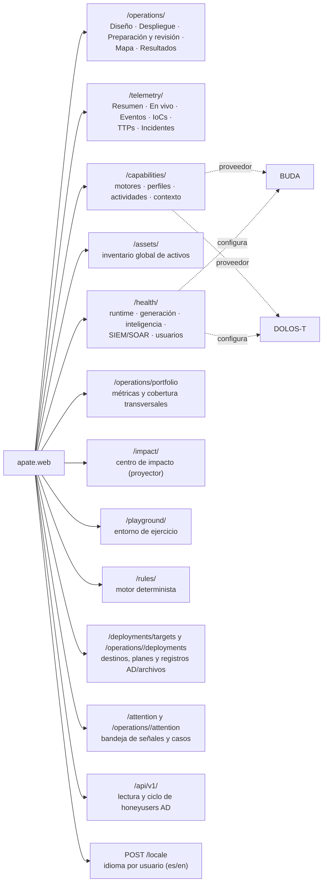

**APATE — Diagramas de arquitectura**

*Complementario a `docs/diseno.md` (arquitectura y justificación en prosa) y `AGENTS.md` (mapa rápido
de orientación). El grafo base se generó leyendo los imports reales de `src/apate/*`; las
incorporaciones posteriores están anotadas debajo. Si el código se reorganiza, regenerar el grafo
contra los imports reales.*

---

# 1. Dependencias entre paquetes (`src/apate/`)

Grafo base de imports por capas. `apate.telemetry.external_bridge` reutiliza el cliente HTTP de
Elasticsearch de `apate.playground.elastic` en vez de duplicarlo (ver la nota debajo del diagrama).
Los módulos posteriores se detallan tras el grafo.



**La excepción de capas, explícita:** `apate.telemetry.external_bridge` (el puente de telemetría
genérico) importa `fetch_recent_hits()` de `apate.playground.elastic`, que está una capa más
arriba. Es deliberado: ese cliente mínimo de Elasticsearch —escrito con `urllib`, sin dependencia
nueva— ya estaba probado contra un índice real, y generalizarlo con un parámetro de campo de
tiempo era preferible a duplicarlo. No hay ciclo a nivel de módulo (`playground.session` importa
`telemetry.collector`, `telemetry.external_bridge` importa `playground.elastic`, y ninguno de esos
cuatro módulos se importa entre sí), pero sí una dependencia mutua a nivel de paquete: si ese
cliente se extrae alguna vez a un módulo neutral, la excepción desaparece.

`apate.i18n` está en la capa 0 y **no importa Flask**: `gettext()` delega en `flask_babel` solo si hay
un contexto de aplicación con la extensión inicializada, y si no devuelve el `msgid` — que *es* la
frase en español, no un modo de error. Por eso `apate.plugins` y `apate.assets` pueden marcar texto
visible sin arrastrar la interfaz web, y una llamada desde `examples/seed_demo.py` o desde un test sin
aplicación sigue produciendo texto correcto. El español es el idioma fuente y no tiene catálogo propio
(sería una copia de sí mismo); el inglés vive en `apate/web/translations/en`.

`apate.deployment` separa el activo protegido, el destino técnico y la ejecución persistida; conserva
una instantánea del destino dentro del plan confirmado y deja los secretos como referencias. Administra
honeyusers de Active Directory mediante WinRM y honeyfiles en filesystem local o SMB montado. El
control web está en `apate.web.blueprints.deployments`; la API de máquina v1 expone únicamente el ciclo
de honeyusers AD con tokens, scopes, idempotencia y auditoría propios. El contrato completo está en
`docs/deployment-connector-contract.md` y el alcance de la API en `docs/api-automatizacion.md`.

`apate.attention` crea señales y casos respaldados por telemetría persistida; `apate.api` custodia
tokens de máquina para el blueprint API y `apate.backup` es una herramienta CLI de copia y
restauración verificables. Los exportadores manuales viven en `apate.telemetry`.

`apate.audit` no depende de ningún otro paquete de `apate` ni el bus de eventos lo toca — escribe
directo al repositorio desde el handler HTTP (`apate.web`), decisión confirmada durante la
investigación de la Fase 7 post-BlackHat (ver `docs/roadmap.md`). `apate.core` no tiene ninguna
dependencia externa: el modelo de dominio se puede usar como biblioteca sin arrastrar la interfaz web
ni el motor. `apate.data` (no es un paquete de código) contiene los datasets curados de ATT&CK,
Engage, plantillas de operación, sugerencias y TTPs del laboratorio.

---

# 2. Flujo de un evento, de punta a punta

```mermaid
sequenceDiagram
    participant I as ActivityIngestionService<br/>/ ExternalTelemetryBridge
    participant P as DeceptionPlugin<br/>(mock · honeytoken · dolost · buda ·<br/>canarytoken · opencanary)
    participant B as EventBus<br/>(síncrono, in-process)
    participant R as RuleEngine
    participant T as TelemetryCollector
    participant Rep as apate.reporting

    opt sondeo periódico (5 s) o consulta del puente externo
        I->>P: check_activity() / fetch()
        Note over I,B: bus EFÍMERO por operación y ciclo —<br/>el bus no permite desuscribirse, así que<br/>reutilizarlo acumularía listeners
    end
    P->>B: publish(PluginEvent: interaction | ttp_observed)
    B->>R: handle_event(event)
    B->>T: on_event(event) → normaliza a TelemetryRecord/IoC

    Note over R: roe.permits() antes de<br/>cada Action; max_actions_per_event<br/>como tope de cascada

    alt regla matchea y la acción está permitida
        R->>P: deploy() / rotate() / retire()
        Note over P,B: la llamada puede volver a publicar<br/>un evento nuevo ANTES de retornar —<br/>reentrancia síncrona real, misma pila
        P->>B: publish(evento nuevo)
    else acción bloqueada o fallida
        R->>R: RejectedAction persistida<br/>(kind: roe | cascade_limit | execution_error,<br/>regla, acción, evento disparador, motivo)
    end

    Note over T: backend SQLite por defecto<br/>(telemetry.db, todas las operaciones)<br/>consulta agrupada de registros completos

    Rep->>T: list_events() / list_iocs() / list_ttps()
    Rep->>Rep: generate_report() —<br/>esperadas vs. observadas vs. inesperadas
```

Puntos que no son obvios leyendo el código de a un archivo por vez:

- `EventBus.publish()` es **síncrono y sin cola** — todo pasa en el mismo hilo, antes de que `publish()`
  retorne. Investigado a fondo antes de decidir no cambiarlo (Fase 7 post-BlackHat, `docs/roadmap.md`):
  el motor de reglas depende de esa reentrancia real, y la suite entera de tests asume entrega
  síncrona.
- Las acciones manuales de operador (paneles nativos de `apate.web`, ej. "Deploy" en la UI) **ejecutan
  la capacidad directamente, sin pasar por la guarda de RoE** — pero el evento que publican **sí** se
  evalúa contra las reglas globales, con un motor efímero por request
  (`apate/web/_rule_engine_runtime.py`), y cualquier acción derivada de una regla sí pasa por las tres
  guardas. `RulesOfEngagement.permits()` gobierna la automatización, nunca el click manual — decisión
  explícita, no un bug (ver revisión de seguridad post-vendorizado en `docs/roadmap.md`). El click
  queda cubierto por `apate.audit` (`OperatorAction`, cadena de hashes verificable).
- El orden de suscripción es fijo en las tres vías: **`TelemetryCollector` → `RuleEngine` → guardado de
  la operación**. Así una transición disparada por regla ya está aplicada y registrada cuando se
  persiste la operación, y ninguna decisión queda registrada sobre un estado que no se guardó.
- `APATE_TELEMETRY_RULES_ENABLED=False` apaga la reacción automática sobre telemetría autónoma **sin**
  apagar la recolección.

---

# 3. Ciclo de vida de una `Operation`



Transiciones exactas, contra `_ALLOWED_TRANSITIONS` (`apate/core/models.py`) — `compromised` **no**
puede volver a `active` (a diferencia de una versión anterior de este diagrama, corregida tras un
hallazgo real de orientación de Codex): una vez comprometida, la única transición hacia adelante es
`closed`.

`closed → planning` no es una transición de la misma instancia — "Reoperar" arma el formulario de una
operación **nueva**, precargado con las TTPs esperadas originales más las observadas-e-inesperadas del
informe de la operación cerrada. Las transiciones de estado quedan auditadas (`Operation`, ver
`apate.core.models`).

---

# 4. Ciclo de vida de un `DeceptionPlugin`



Contrato completo (incluidas las validaciones de M9 que le pegan a un plugin externo) en
`docs/plugin-event-contract.md`.

---

# 5. Arquitectura de información web

La operación sigue siendo el objeto central. Los blueprints se organizan por función y no por la
herramienta vendorizada que provee una capacidad:



El detalle de una operación tiene cinco tabs: **Diseño** (pasos 1-5 de la metodología, en secciones
plegables), **Despliegue**, **Preparación y revisión** (cobertura estratégica de Engage + ensayo en
seco + coherencia de la ficción), **Mapa** (lentes de estructura, evidencia, resumen y activos) y
**Resultados** (métricas, informes, heatmap, línea de tiempo). Los identificadores de fragmento
históricos (`#tab-profile`, `#tab-roe`, `#tab-plugins`, …) se conservan y el resolvedor de hash abre el
tab que contiene la sección, para que los enlaces profundos sigan funcionando.

`BUDA` y `DOLOS-T` son proveedores o motores secundarios, nunca categorías de navegación. El
namespace histórico `/tools/...` fue retirado en la Fase 8 después de demostrar paridad en los
destinos anteriores; no hay un blueprint `tools.py`. `/plugins/` conserva únicamente una redirección
de entrada a `/capabilities/` para enlaces históricos, mientras toda navegación propia usa el destino
canónico.
